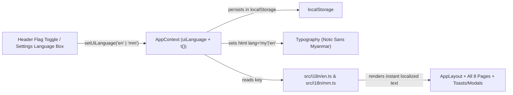

# QuizClash Frontend — Myanmar & English (MM/ENG) Full UI i18n Implementation Plan

## Goal Description
Enable complete, instant **English (`en`)** and **Myanmar (`mm`)** language switching across the entire QuizClash frontend—covering navigation, all 8 screens, modals, toast notifications, and Myanmar Unicode typography—powered by the existing `uiLanguage` state in `src/context/AppContext.tsx` and the synced header/settings flag toggles.



---

## User Review Required

> [!IMPORTANT]
> **Key Design Choices to Confirm Before Execution:**
> 1. **Zero-dependency typed i18n vs. `react-i18next`:**
>    - **Recommended:** Lightweight, strongly-typed TypeScript dictionaries (`src/i18n/en.ts`, `src/i18n/mm.ts`, `src/i18n/index.ts`) with a `useTranslation()` / `t(key, params?)` helper. Zero extra npm packages, full TypeScript autocomplete & compile-time missing-key checking, and instant switching.
>    - Alternative: Install `i18next` + `react-i18next` (useful only if you plan to add 5+ languages or lazy-load translation bundles later).
> 2. **Myanmar Typography (`Noto Sans Myanmar`):**
>    - Myanmar script has taller ascenders/descenders and needs slightly looser `line-height` (e.g., `1.65`) when `<html lang="my">` is active so stacked diacritics never clip. Adding Google Fonts `Noto Sans Myanmar` in `index.html` + `html[lang="my"]` font rules in `src/index.css` keeps Myanmar text crisp on all OSes.
> 3. **Seed/Demo Quiz Content (`src/data/seedData.ts`):**
>    - Keep sample quiz questions (`Cell structure`, `World history`, `Chemistry basics`) in English (representing user-uploaded study notes), while translating **all application chrome, headings, buttons, labels, tooltips, toasts, and modals**.

---

## Proposed Changes

### Stage 1: Core i18n Infrastructure & Myanmar Typography

#### [NEW] `src/i18n/en.ts`
- Define the complete English translation dictionary organized by namespace:
  - `common` (buttons: Save, Cancel, Delete, Back, Next, Previous, Close, Export, etc.)
  - `nav` (Workspace, Your Library, Dashboard, Generate quiz, My quizzes, Attempt history, Live games, Help & settings, Join game, tagline)
  - `dashboard` (Screen 01 headings, stat card labels, banners, table headers, callouts)
  - `generate` (Screen 02 3-step labels, dropzone copy, settings labels, format options, summary callout)
  - `review` (Screen 03 quiz switcher, editor controls, export options, printable worksheet labels)
  - `solo` (Screen 04 progress labels, answered/remaining counter, navigation, Finish quiz)
  - `results` (Screen 05 stat cards, missed questions review, attempt history table headers, actions)
  - `lobby` (Screen 06 Room PIN banner, Copy PIN/link, Connected players, Game setup, Join form)
  - `leaderboard` (Screen 07 round banner, standings table, last round summary, Next question)
  - `settings` (Screen 08 tabs, Profile, Appearance, Language, Quiz defaults, Notifications, Privacy & account, footer bar)
  - `toasts` & `modals` (all SweetAlert2 toast and confirmation modal strings with `{{param}}` interpolation)

#### [NEW] `src/i18n/mm.ts`
- Mirror the exact TypeScript type `typeof en` (`Record` / nested object shape) with natural, idiomatic **Myanmar Unicode** translations for every key so TypeScript guarantees zero missing keys.

#### [NEW] `src/i18n/index.ts`
- Export `translate(lang: AppLanguage, key: TranslationKey, params?: Record<string, string | number>): string` supporting `{{variable}}` interpolation (e.g., `Question {{current}} of {{total}}`).
- Re-export error helpers from `src/i18n/errors.ts`.

#### [MODIFY] `src/context/AppContext.tsx`
- Expose `t(key, params?)` directly on `AppContextValue` (bound to `uiLanguage`).
- Replace hardcoded English strings in `showToast(...)` and `openModal(...)` calls inside `AppContext` (`saveQuizChanges`, `generateQuiz`, `finishPractice`, `exportStudySheet`, `joinLiveRoom`, `advanceLiveRound`, `resetAllData`) with `t(...)`.

#### [MODIFY] `index.html` & `src/index.css`
- Load `Noto Sans Myanmar` (`400`, `500`, `600`, `700`) via Google Fonts in `index.html` (with `display=swap`).
- Add `html[lang="my"]` typography rules in `src/index.css` so Myanmar UI text uses `'Noto Sans Myanmar'` with comfortable `line-height` and never clips buttons/badges.

---

### Stage 2: Application Shell & Shared Components

#### [MODIFY] `src/components/layout/AppLayout.tsx`
- Translate desktop sidebar links, mobile drawer links, section headings (`WORKSPACE`, `YOUR LIBRARY`), header tagline, `Join game` / `Join`, `Help & settings`, `Skip to content`, and printable study sheet headers.

#### [MODIFY] `src/components/common/AppPagination.tsx`
- Translate pagination aria-labels and Previous/Next labels if present.

---

### Stage 3: Screen-by-Screen UI Translation (Screens 01–08)

#### [MODIFY] `src/pages/DashboardPage.tsx` (Screen 01)
- Translate header eyebrow/title/subtitle, `+ Create a quiz`, stat card labels, `Start from a document` banner, `Recent quizzes` table headers, and `Continue learning` cards.

#### [MODIFY] `src/pages/GenerateQuizPage.tsx` (Screen 02)
- Translate 3-step indicator, file upload dropzone, file validation messages, `02 / Quiz settings` labels, Select options, `READY TO GENERATE` summary, and `Generate quiz →` button.

#### [MODIFY] `src/pages/ReviewExportPage.tsx` (Screen 03)
- Translate `Switch Quiz`, toolbar actions, question editor labels, `UP NEXT`, `Quiz options` (`Print or study offline`, PDF/Word toggles, download buttons), and save toasts.

#### [MODIFY] `src/pages/SoloQuizPage.tsx` (Screen 04)
- Translate header, `Save & exit`, progress summary (`Question X of N`, `X answered · Y remaining`), `Your progress` sidebar, and `Finish quiz`.

#### [MODIFY] `src/pages/ResultsHistoryPage.tsx` (Screen 05)
- Translate attempt summary stat cards, `Review the questions you missed` labels (`Your answer`, `Correct answer`), attempt history table columns, and bottom action buttons.

#### [MODIFY] `src/pages/LiveLobbyPage.tsx` (Screen 06)
- Translate Room PIN banner, `Copy PIN`, `Copy invite link`, `Connected players`, `Start game →`, `Game setup` Select labels, and `Joining someone else?` form + toasts.

#### [MODIFY] `src/pages/LiveLeaderboardPage.tsx` (Screen 07)
- Translate round completion banner, `Current standings` headers, `Last round` summary, and `Next question →`.

#### [MODIFY] `src/pages/SettingsPage.tsx` (Screen 08)
- Translate page header, all 4 tab labels (keeping internal tab IDs `'Profile' | 'Quiz defaults' | 'Notifications' | 'Privacy & account'` stable so persisted settings never break), Profile/Appearance/Language/Quiz defaults/Notifications/Privacy cards, modal prompt, and footer bar.

---

## Verification Plan

### Automated Tests
1. TypeScript type-checking & Vite production build (also verifies 100% key parity between `en.ts` and `mm.ts`):
   ```bash
   npm run build
   ```
2. ESLint check across all new & modified files:
   ```bash
   npx eslint src/i18n/ src/context/AppContext.tsx src/components/layout/AppLayout.tsx src/pages/
   ```

### Manual Verification
1. Click the **UK / Myanmar flag toggle** in the top header and verify all navigation items, headings, buttons, and labels switch immediately without page reload.
2. Verify switching language from **Settings → Profile → Language** stays in sync with the header toggle and persists after a browser refresh (`F5`).
3. Visit all 8 screens (`/dashboard`, `/generate`, `/quizzes`, `/play`, `/history`, `/lobby`, `/leaderboard`, `/settings`) in **Myanmar (`mm`)** mode on both desktop and mobile widths (`375px`) to confirm:
   - No clipped Myanmar text or overflowing buttons/tabs.
   - Select dropdowns, toggle boxes, modals, and toast notifications all render cleanly in Myanmar.
