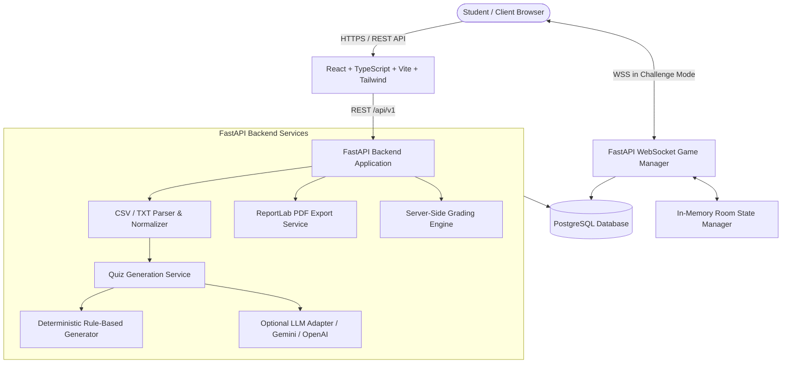
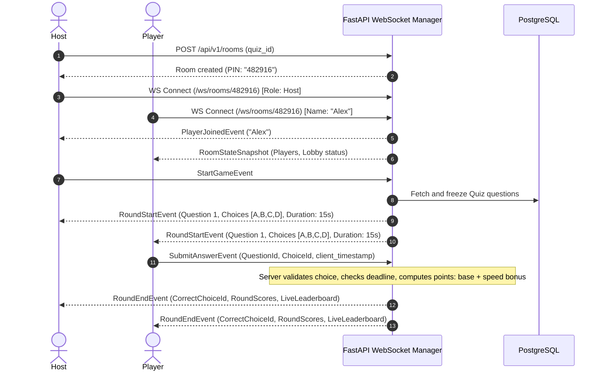

# QuizClash — System Design Document

**Status:** Updated to align with [QuizClash Technical Plan & System Architecture](../../QuizClash_Technical_Plan.md)  
**Last Updated:** November 2026  
**Architecture:** Separate React frontend and Python FastAPI backend in a unified monorepo with PostgreSQL persistence  

---

## 1. Abstract

**QuizClash** converts personal study files into validated multiple-choice quizzes for printable study, solo practice, and synchronized multiplayer competition. This system design documents the production architecture consisting of a React + TypeScript + Vite client, a Python + FastAPI backend, a PostgreSQL relational database with SQLAlchemy 2.x and Alembic migrations, a ReportLab PDF generation service, and a native FastAPI WebSocket real-time game engine.

The architecture prioritizes data security and academic integrity: the backend strictly owns answers, grading, and access checks; answer keys are never delivered to playable client payloads.

---

## 2. Goals and Non-Goals

### Goals
- **Automated Quiz Generation:** Ingest CSV and TXT files in MVP (expanding to PDF/DOCX in Phase 4) and produce structured 4-choice MCQs with plausible distractors via rule-based extraction or an optional LLM adapter.
- **Academic Integrity:** Server-side grading only. Playable endpoints (`GET /api/v1/quizzes/{id}`) omit `is_correct` flags.
- **Offline Study Documents:** Render clean questions-only PDFs and separate owner-authorized answer-key PDFs using ReportLab with full Unicode/CJK support for Japanese text.
- **Solo Dashboard & History:** Save attempts, calculate scores server-side, and maintain persistent user quiz libraries in PostgreSQL.
- **Synchronized Multiplayer (Challenge Mode):** Host PIN-based rooms, broadcast questions, enforce server-side round deadlines, award speed/accuracy points, and synchronize live leaderboards over native WebSockets.
- **Independent Deployability:** Maintain decoupled frontend and backend services in a unified monorepo with Docker Compose orchestration.

### Non-Goals
- OCR for scanned physical documents (MVP scope is text-based digital notes).
- Unreviewed factual guarantee: AI-generated questions provide an editable preview before publishing.
- Horizontally distributed multiplayer clustering across multiple servers in Phase 1 (in-memory room management on a single FastAPI instance is used for the prototype, with Redis clustering planned for high-scale multi-instance deployment).

---

## 3. High-Level Architecture & Data Flow

---

## 4. Core Component Responsibilities

| Component | Technology | Responsibility | Storage / State |
|---|---|---|---|
| **Web Frontend** | React, TypeScript, Vite, Tailwind CSS | File upload UI, editable quiz preview, solo quiz player, results review, and multiplayer lobby/round screens. | Client-side memory & route state |
| **API Backend** | Python 3.12+, FastAPI, Pydantic | REST API routing, request validation, CORS, error handling, and orchestration. | Stateless async workers |
| **Parser & Ingestion** | Python `csv`, text utilities | Validates file format, UTF-8/CJK encoding, size limits, and extracts term/definition pairs. | Temporary files (cleaned up immediately) |
| **Quiz Generator** | Rule engine + LLM adapter | Generates 4-choice questions; samples 3 unique distractors; validates JSON invariants via Pydantic. | Ephemeral generation context |
| **Relational Database** | PostgreSQL, SQLAlchemy 2.x, Alembic | Persistent storage for users, quizzes, questions, choices, attempts, and attempt answers. | PostgreSQL persistent volume |
| **Export Service** | ReportLab | Generates printable Questions-Only and Answer-Key PDFs with embedded CJK fonts. | Streaming file responses |
| **Realtime Engine** | FastAPI WebSockets | Manages PIN rooms, round state transitions, authoritative timers, scoring, and leaderboard broadcasts. | In-memory `RoomSession` dictionary |

---

## 5. API and Data Contracts

### 5.1. Planned API Endpoints (`/api/v1`)

| Method | Endpoint | Description | Phase |
|---|---|---|---|
| `GET` | `/api/v1/health` | Service health status check | 1 |
| `POST` | `/api/v1/quizzes` | Upload CSV/TXT file and generate quiz draft | 1 |
| `GET` | `/api/v1/quizzes/{id}` | Retrieve playable quiz (answer keys omitted) | 1 |
| `GET` | `/api/v1/quizzes/{id}/preview` | Owner-only preview with correct choices displayed | 1 |
| `PATCH` | `/api/v1/quizzes/{id}` | Update/edit quiz title, question prompts, and choices | 1 |
| `GET` | `/api/v1/quizzes/{id}/exports?kind=questions` | Download Questions-Only PDF | 1 |
| `GET` | `/api/v1/quizzes/{id}/exports?kind=answers` | Download owner-authorized Answer-Key PDF | 1 |
| `POST` | `/api/v1/quizzes/{id}/attempts` | Submit answers for server-side grading and scoring | 2 |
| `GET` | `/api/v1/attempts/{id}` | Retrieve attempt score, statistics, and answer review | 2 |
| `GET` | `/api/v1/me/quizzes` | List user's saved quizzes | 2 |
| `POST` | `/api/v1/rooms` | Create a Challenge Mode room and generate 6-digit PIN | 3 |
| `WS` | `/api/v1/ws/rooms/{pin}` | Real-time WebSocket connection for room lobby and gameplay | 3 |

### 5.2. Data Model Summary (PostgreSQL)

- **`users`**: `id`, `email`, `password_hash`, `created_at`
- **`quizzes`**: `id`, `owner_id`, `title`, `source_type`, `source_hash`, `status`, `created_at`
- **`questions`**: `id`, `quiz_id`, `prompt`, `position`
- **`choices`**: `id`, `question_id`, `text`, `is_correct`, `position`
- **`attempts`**: `id`, `quiz_id`, `user_id`, `score`, `total_questions`, `completed_at`
- **`attempt_answers`**: `id`, `attempt_id`, `question_id`, `choice_id`, `is_correct`
- **`rooms`** (Phase 3): `id`, `quiz_id`, `host_id`, `pin`, `status`, `created_at`

---

## 6. Real-Time Multiplayer Protocol (Challenge Mode)

Multiplayer communication operates over native WebSockets using structured JSON message events:

---

## 7. Security, Integrity, and Operational Invariants

1. **Answer Key Protection:** The database stores `is_correct` on choices, but this attribute is filtered out by Pydantic response models on all player-facing endpoints.
2. **Server-Authoritative Grading:** Client submissions pass choice IDs only. The server calculates results; client scores are completely ignored.
3. **File Validation & Sanitization:** Strict validation of MIME types, magic bytes, and file size (max 10 MB). Temporary upload files are deleted immediately after parsing.
4. **Credential Isolation:** LLM API keys and database credentials reside exclusively in backend environment variables (`.env`), never exposed to frontend code or client bundles.
5. **Unicode / Japanese Character Preservation:** Database connections use UTF-8; ReportLab embeds Unicode TrueType fonts (e.g. Heiti/Mincho or Noto Sans CJK) to guarantee Japanese vocabulary displays accurately without garbled characters.
