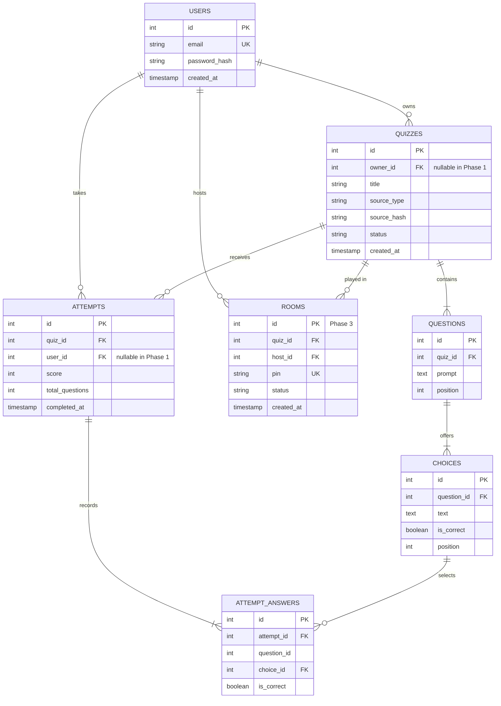

# QuizClash Database Schema & Data Dictionary

**Status:** Updated to align with [QuizClash Technical Plan & System Architecture](../../QuizClash_Technical_Plan.md) and SQLAlchemy backend models.  
**Database Engine:** PostgreSQL (managed with SQLAlchemy 2.x and Alembic migrations)  
**Previous Architecture Note:** The early prototype's single-file JSON store model (`store.schemaVersion`, `store.users`, etc.) has been superseded by a normalized relational PostgreSQL schema to support ACID guarantees, concurrent users, secure ownership boundaries, and server-side grading integrity.

---

## 1. Entity-Relationship Overview



---

## 2. PostgreSQL Relational Tables

### Table: `users` (Phase 2)
Stores registered user identities and credentials for authentication, dashboard history, and room ownership.

| Column | Data Type | Constraints | Description | Data Cleaning & Security Invariants |
|---|---|---|---|---|
| `id` | `INTEGER` | Primary Key, Auto-increment | Unique identifier for the user. | Server-generated. |
| `email` | `VARCHAR(255)` | Unique, Not Null, Indexed | User login email. | Trim whitespace, normalize to lowercase, validate standard email format. |
| `password_hash` | `VARCHAR(255)` | Not Null | Cryptographic hash of user password. | Hashed using bcrypt or Argon2; plaintext passwords must never be stored or logged. |
| `created_at` | `TIMESTAMP WITH TIME ZONE` | Default `now()`, Not Null | Account registration timestamp. | Server-assigned UTC timestamp. |

### Table: `quizzes`
Stores quiz metadata, ingestion source provenance, and publication status.

| Column | Data Type | Constraints | Description | Data Cleaning & Security Invariants |
|---|---|---|---|---|
| `id` | `INTEGER` | Primary Key, Auto-increment | Unique identifier for the quiz. | Server-generated; stable identifier for API and exports. |
| `owner_id` | `INTEGER` | Foreign Key (`users.id`), Nullable in Phase 1 | Associated creator / owner. | Nullable for guest MVP; bound to authenticated `user.id` in Phase 2. Client-supplied IDs are rejected. |
| `title` | `VARCHAR(255)` | Not Null, Default 'Untitled Quiz' | Display title of the quiz. | Trim outer whitespace; reject empty strings; sanitize for HTML/PDF rendering. |
| `source_type` | `VARCHAR(50)` | Not Null | Source format: `csv`, `txt`, `structured`, `llm` (later `pdf`, `docx`). | Normalized to lowercase; validated against supported types. |
| `source_hash` | `VARCHAR(64)` | Nullable | SHA-256 hash of raw input file. | Computed server-side for deduplication and generation caching. |
| `status` | `VARCHAR(50)` | Not Null, Default 'draft' | Lifecycle: `draft`, `published`, `archived`. | Only validated quizzes with sufficient valid questions can be published. |
| `created_at` | `TIMESTAMP WITH TIME ZONE` | Default `now()`, Not Null | Creation timestamp. | Server-assigned UTC timestamp. |

### Table: `questions`
Stores individual multiple-choice question prompts belonging to a quiz.

| Column | Data Type | Constraints | Description | Data Cleaning & Security Invariants |
|---|---|---|---|---|
| `id` | `INTEGER` | Primary Key, Auto-increment | Unique identifier for the question. | Server-generated. |
| `quiz_id` | `INTEGER` | Foreign Key (`quizzes.id`), Not Null | Parent quiz reference. | Cascade deletes when parent quiz is deleted (`cascade="all, delete-orphan"`). |
| `prompt` | `TEXT` | Not Null | The question or term to be answered. | Trim whitespace; preserve Unicode / Japanese CJK characters intact; escape in UI. |
| `position` | `INTEGER` | Not Null, Default 0 | Order position in the quiz. | Zero-indexed integer. |

### Table: `choices`
Stores multiple-choice options for each question. **Crucial:** the `is_correct` flag is kept private on the server during ordinary quiz play.

| Column | Data Type | Constraints | Description | Data Cleaning & Security Invariants |
|---|---|---|---|---|
| `id` | `INTEGER` | Primary Key, Auto-increment | Unique identifier for the choice. | Server-generated. |
| `question_id` | `INTEGER` | Foreign Key (`questions.id`), Not Null | Parent question reference. | Cascade deletes with parent question. |
| `text` | `TEXT` | Not Null | Display text of the choice. | Trim whitespace; reject duplicate choice text within the same question; preserve Unicode. |
| `is_correct` | `BOOLEAN` | Not Null, Default `FALSE` | Private correctness flag. | **Security invariant:** Exactly one choice per question must have `is_correct = TRUE`. Must NEVER be leaked in `/quizzes/{id}` play API. |
| `position` | `INTEGER` | Not Null, Default 0 | Display order position. | Shuffled during play; stable during export. |

### Table: `attempts`
Stores completed solo quiz runs and server-calculated scores.

| Column | Data Type | Constraints | Description | Data Cleaning & Security Invariants |
|---|---|---|---|---|
| `id` | `INTEGER` | Primary Key, Auto-increment | Unique identifier for the attempt. | Server-generated. |
| `quiz_id` | `INTEGER` | Foreign Key (`quizzes.id`), Not Null | Quiz taken in this attempt. | Must reference a published, ready quiz. |
| `user_id` | `INTEGER` | Foreign Key (`users.id`), Nullable in Phase 1 | Registered user taking the attempt. | In Phase 2, bound to authenticated user. |
| `score` | `INTEGER` | Not Null, Default 0 | Number of correct answers. | **Security invariant:** Computed strictly server-side by grading submitted choice IDs against DB. Client scores are ignored. |
| `total_questions` | `INTEGER` | Not Null | Total number of questions in quiz. | Derived from the parent quiz. |
| `completed_at` | `TIMESTAMP WITH TIME ZONE` | Default `now()`, Not Null | Submission timestamp. | Server-assigned UTC timestamp. |

### Table: `attempt_answers`
Stores itemized audit log of each question answered within an attempt.

| Column | Data Type | Constraints | Description | Data Cleaning & Security Invariants |
|---|---|---|---|---|
| `id` | `INTEGER` | Primary Key, Auto-increment | Unique record identifier. | Server-generated. |
| `attempt_id` | `INTEGER` | Foreign Key (`attempts.id`), Not Null | Parent attempt reference. | Cascade deletes with parent attempt. |
| `question_id` | `INTEGER` | Not Null | Question answered. | Validated to ensure question belongs to the target quiz. |
| `choice_id` | `INTEGER` | Foreign Key (`choices.id`), Not Null | Choice selected by user. | Validated to ensure choice belongs to `question_id`. |
| `is_correct` | `BOOLEAN` | Not Null | Evaluated correctness result. | Server-evaluated at submission time. |

### Table: `rooms` (Phase 3 — Database Persistence)
Stores metadata for Challenge Mode game rooms.

| Column | Data Type | Constraints | Description | Data Cleaning & Security Invariants |
|---|---|---|---|---|
| `id` | `INTEGER` | Primary Key, Auto-increment | Unique room identifier. | Server-generated. |
| `quiz_id` | `INTEGER` | Foreign Key (`quizzes.id`), Not Null | Quiz frozen for the room. | Must reference a published quiz. |
| `host_id` | `INTEGER` | Foreign Key (`users.id`), Not Null | Host user reference. | Authenticated host identity. |
| `pin` | `VARCHAR(6)` | Unique, Not Null, Indexed | 6-character room PIN. | Generated server-side; alphanumeric or 6 digits. Enforce uniqueness among active rooms. |
| `status` | `VARCHAR(50)` | Not Null, Default 'lobby' | State: `lobby`, `active`, `finished`, `closed`. | Server-managed state machine. |
| `created_at` | `TIMESTAMP WITH TIME ZONE` | Default `now()`, Not Null | Room creation timestamp. | Server-assigned UTC timestamp. |

---

## 3. In-Memory Live Multiplayer Model (Phase 3 WebSockets)

Active rooms maintain high-frequency synchronized state in memory on the FastAPI server (using Python `asyncio` locks and native WebSockets):

```text
RoomSession:
├── room_id: int
├── pin: str
├── host_id: int
├── quiz_snapshot: dict (frozen questions & choices)
├── current_round: int
├── round_state: "waiting" | "in_progress" | "ended"
├── round_deadline: float (epoch timestamp)
├── players: Dict[player_id, PlayerState]
│    ├── player_id: str
│    ├── user_id: Optional[int]
│    ├── display_name: str
│    ├── total_score: int
│    ├── is_connected: bool
│    └── websocket: WebSocket
└── round_answers: Dict[round_index, Dict[player_id, AnswerSubmission]]
     ├── choice_id: int
     ├── received_at: float
     ├── response_time_ms: int
     └── points_awarded: int
```

- **Server-Controlled Timing:** Round start and end are dictated by server timestamps. Submissions received after `round_deadline` are strictly rejected.
- **Dynamic Scoring:** Points awarded = `Base_Points + Latency_Bonus` if correct, `0` if incorrect.
- **Failover / Scaling:** A single FastAPI instance hosts the in-memory rooms for the Phase 3 prototype; scaling across multiple worker processes will use Redis Pub/Sub.

---

## 4. Key Validation & Security Invariants

1. **Choice Count & Uniqueness:** Every ready multiple-choice question must have exactly 4 choices, with 1 correct choice and 3 distinct distractors.
2. **Answer Concealment:** The endpoint `GET /api/v1/quizzes/{id}` returns questions and choices **without** `is_correct`. Only owner-authorized endpoints (`/quizzes/{id}/preview` and `/exports?kind=answers`) reveal the answer key.
3. **Server-Side Grading:** The client submits `{ answers: [{ question_id, choice_id }] }`. The backend evaluates correctness against database records and computes the score. Client-supplied scores are discarded.
4. **Duplicate Protection:** An attempt cannot be submitted more than once for the same transaction.
5. **Unicode & Japanese Content:** All text columns (`prompt`, `text`, `title`) use UTF-8 encoding in PostgreSQL to guarantee Japanese Kanji/Kana and specialized symbols remain intact from upload to PDF export.
