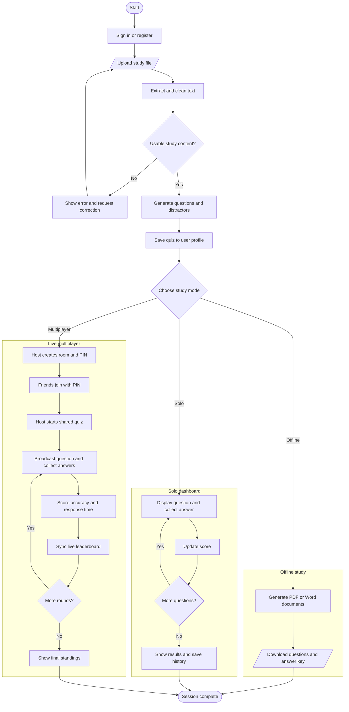

# Quiz Clash project flowchart

This chart describes the proposed application, not verified implementation. It uses the expanded Word proposal as the broader scope, alongside the original Markdown proposal. The expanded scope includes PDF and DOCX uploads, Word exports, user history, and live multiplayer as a core feature.

Sources:
- [Original proposal](project_proposal_auto_quiz_generator%20%281%29.md)
- [Expanded proposal](Project_Proposal_Auto_Quiz_Generator_Expanded.docx)

## Flow in plain language

1. Sign in or register to associate generated quizzes with a user profile.
2. Upload PDF, DOCX, CSV, or TXT study material. Extract and normalize the text. If the content is unusable, correct it and upload again.
3. Use an LLM to generate multiple-choice questions and plausible wrong answers, then associate the quiz with the user's profile in the initial JSON storage model.
4. Choose a mode:
   - Offline: generate PDF or Word documents for the questions and a separate answer key, then download them.
   - Solo: answer each question, update the score, and repeat until complete; display results and save history.
   - Multiplayer: host a PIN-based room, let friends join, and start the shared quiz. Score each round by accuracy and response time, synchronize the leaderboard, and repeat until final standings.
5. Finish the study or game session.

## Source mapping

| Proposal feature | Flowchart representation |
| --- | --- |
| Basic user authentication and linked profiles | Sign in or register; save quiz to user profile |
| PDF, Word, CSV, and text ingestion; text cleaning | Upload study file; extract and clean text |
| LLM-generated quizzes with distractors | Generate questions and distractors |
| Questions and separate answer-key exports | Offline study branch |
| Interactive solo quiz, results, and profile history | Solo dashboard branch |
| Room PIN, Socket.io, dynamic scoring, live leaderboards | Live multiplayer branch |

## Assumptions and gaps

- Authentication appears first for clarity; the proposals do not specify whether guest uploads or guest multiplayer players are allowed.
- The unusable-content retry is an inferred validation step. Exact file limits, parsing errors, and AI-generation retry behavior are unspecified.
- The host starting the game and the repeated question/round loops are inferred from the described interactive modes. Round timing and game-end rules are unspecified.
- The chart follows the expanded proposal: multiplayer is a core mode there, although it is a stretch goal in the original proposal.
- JSON storage is the prototype plan. MongoDB is a future migration option, not a required step in this flow.

Possible extensions: separate architecture diagram, detailed multiplayer sequence, or development-roadmap flowchart.
