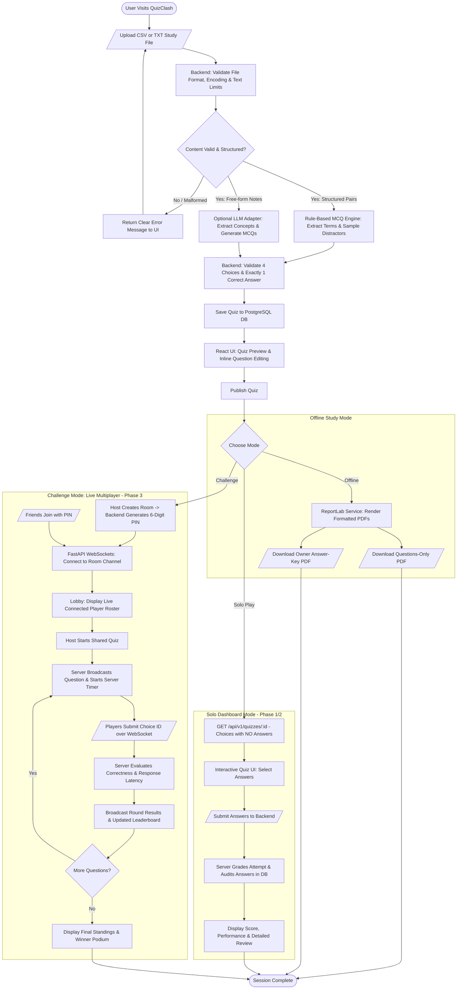

# QuizClash Project Flowchart & System Workflow

**Status:** Updated to align with [QuizClash Technical Plan & System Architecture](../../QuizClash_Technical_Plan.md)  
**Architecture:** React + Vite Frontend, Python + FastAPI Backend, PostgreSQL Database, Native WebSockets  
**Updated:** November 2026  

---

## 1. End-to-End User & System Flowchart

---

## 2. Step-by-Step Flow Explanation

### 1. Ingestion & Validation
- The user uploads a `.csv` or `.txt` file via a drag-and-drop interface in the React application.
- The FastAPI backend validates file MIME type, encoding (UTF-8, supporting Japanese Kanji/Kana), size limit (default 10 MB), and line counts.
- Malformed syntax, blank files, or files with insufficient unique vocabulary (< 4 distinct entries) immediately trigger structured 400 validation error responses.

### 2. Quiz Generation Pipeline
- **Structured Vocabulary (CSV / delimited TXT):** Uses a fast, deterministic Python rule-based generator. The correct definition is paired with the term, and 3 distinct distractors are sampled from the rest of the file's definitions. Options are shuffled with stable IDs assigned.
- **Unstructured Notes:** An optional LLM adapter sends bounded chunks of cleaned text to an AI provider (e.g. Gemini / OpenAI) with strict Pydantic JSON schema constraints.
- **Backend Validation:** Validates that every question has 4 distinct options and exactly 1 correct choice before saving to PostgreSQL as `draft`.

### 3. Preview & Edit
- The user can review the generated questions, edit prompts, replace distractor text, or re-order questions.
- Once satisfied, the user publishes the quiz to make it playable and exportable.

### 4. Mode Selection
- **Offline Mode:** The ReportLab backend service renders two PDFs:
  1. A student questions sheet without answers.
  2. A separate answer key sheet with question numbers and correct choices.
  Both use registered Unicode fonts to properly render Japanese and international text.
- **Solo Dashboard Mode:** The client requests the playable quiz via `GET /api/v1/quizzes/{id}`. **Answer keys are never sent in this payload**. The user answers questions and submits the full attempt to `POST /api/v1/quizzes/{id}/attempts`. The server calculates the score, stores an `Attempt` record and individual `AttemptAnswer` entries, and returns the verified score.
- **Challenge Mode (Phase 3):** The host creates a PIN room. Players connect via native FastAPI WebSockets (`/api/v1/ws/rooms/{pin}`). The server orchestrates synchronized rounds with authoritative countdown timers. Players submit answers in real time, and the backend awards points based on accuracy and speed, streaming live leaderboard updates after each question.

---

## 3. Architecture Alignment

| Previous Proposal / Design Concept | Selected Architecture ([QuizClash Technical Plan](../../QuizClash_Technical_Plan.md)) | Reason for Evolution |
|---|---|---|
| Express.js / Node.js backend | **Python 3.12+ / FastAPI** | Superior text processing, native data science/AI library integration, and high async performance. |
| Single-file JSON store (`store.json`) | **PostgreSQL + SQLAlchemy 2.x + Alembic** | ACID transactional consistency, relational integrity, foreign keys, and scalability. |
| Socket.io | **Native FastAPI WebSockets** | Lightweight, high-throughput, standards-compliant, zero external JS dependency on backend. |
| Client-side `jspdf` / `pdfkit` | **Server-side ReportLab** | Deterministic styling, reliable CJK/Japanese font embedding, secure separation of answer key. |
| Mandatory upfront login | **Guest-friendly Phase 1 MVP -> Authenticated Phase 2** | Lower friction for first-time users to upload notes and print PDFs immediately. |
| PDF/DOCX ingestion in Sprint 1 | **CSV/TXT in MVP; PDF/DOCX in Phase 4** | Focuses on core active-recall question generation reliability before complex layout parsing. |
